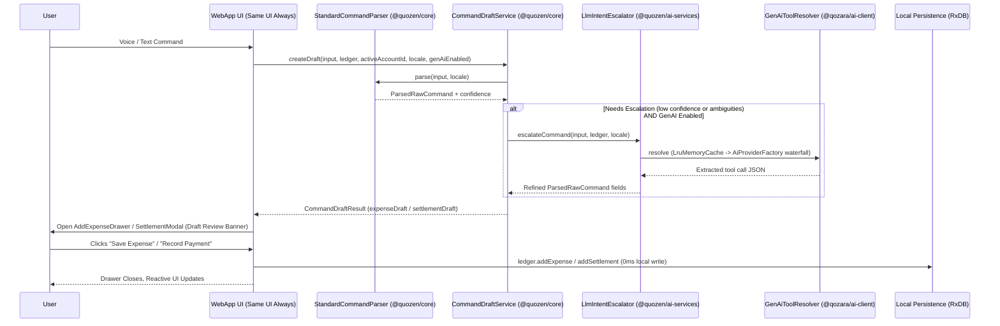

# Agentic UI & Composite AI Command Architecture

## Philosophy: Transparent Composite AI (Symbolic First, GenAI Escalation)

Quozen employs a **Neuro-Symbolic / Composite AI architecture** that combines instant, offline-first deterministic parsing (**Symbolic AI**) with optional **Generative AI (GenAI)** escalation and human-in-the-loop confirmation—completely transparently to the end user:

1. **Everyday Commands (< 1ms, 0 Network Calls)**: Standard expense logs and debt settlements are parsed deterministically using localized pattern grammars (`StandardCommandParser`) and member gazetteers (`CommandDraftService`).
2. **Transparent GenAI Escalation**: When an input has low confidence or unresolved member ambiguities—and GenAI is enabled and online—`CommandDraftService` automatically escalates to `LlmIntentEscalator` (backed by `GenAiToolResolver` from `@qozara/ai-client`). If GenAI is disabled or unreachable, the UI renders identically and gracefully opens the editable draft.
3. **Human-in-the-Loop (Never Auto-Commit)**: Neither deterministic AI nor GenAI writes directly to the ledger. Quozen opens an interactive **Draft Confirmation Dialog** (`AddExpenseDrawer` or `SettlementModal`) pre-populated for user review before committing.

## Request Execution Flow

## Key Architectural Decisions

- **Pure Domain Core**: `@quozen/core` has zero external GenAI dependencies. External LLM bindings live in `@quozen/ai-services`, built on shared `@qozara/ai-client` primitives (`LruMemoryCache`, `AiError`, `GenAiToolResolver`, `AiProviderFactory`).
- **Zero Localhost Probing**: Ollama (`localhost:11434`) is never probed in `auto` or `local` mode unless `enableLocalAi` is explicitly toggled on in Profile settings, eliminating browser Private Network Access prompts.
- **Multilingual Support**: Pattern grammars support English (`en`) and Spanish (`es`) locale packs, handling currency symbols, relative dates, exclusions, and itemized splits.
