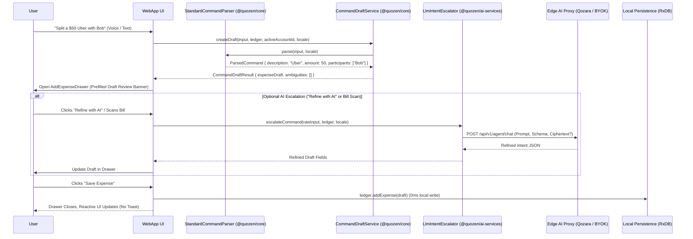

# Agentic UI & Command Parsing Architecture

## Philosophy: Deterministic First, AI on Escalation

Quozen employs a **hybrid architecture** that combines instant, offline-first deterministic parsing with optional hexagonal LLM escalation and human-in-the-loop confirmation:

1. **Everyday Commands (< 1ms, 0 Network Calls)**: Standard expense logs and debt settlements are parsed 100% deterministically using localized pattern grammars (`StandardCommandParser`) and member gazetteers (`CommandDraftService`).
2. **Human-in-the-Loop (Never Auto-Commit)**: The system never writes directly to the ledger. It opens an interactive **Draft Confirmation Dialog** (`AddExpenseDrawer` or `SettlementModal`) pre-populated with parsed values and warnings for user review.
3. **Pragmatic AI Escalation**: We leverage generative LLMs and multimodal vision strictly when genuinely necessary—such as scanning paper receipts/bills, parsing complex unstructured multi-party notes, or when the user explicitly clicks **"Refine with AI"**.

## Request Execution Flow

## Key Architectural Decisions

- **Decoupled Monorepo Structure**: Core logic (`@quozen/core`) contains pure TypeScript parsing algorithms without any AI runtime dependencies. External LLM bindings live in `@quozen/ai-services`.
- **Zero Localhost Probing**: Ollama (`localhost:11434`) is never probed in auto mode unless `enableLocalAi` is explicitly toggled by the user in settings, eliminating browser Private Network Access security popups.
- **Multilingual Support**: Pattern grammars support English (`en`) and Spanish (`es`) locale packs, handling currency symbols, relative dates, exclusions, and itemized splits.
