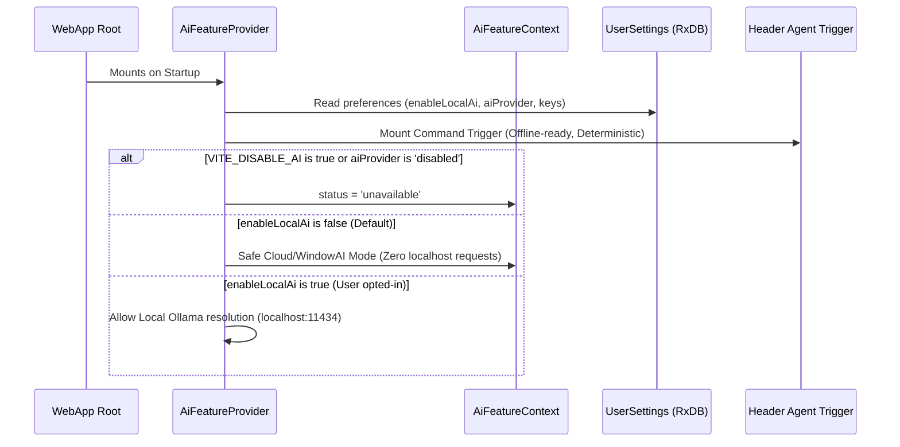

# AI Pre-flight & Availability Architecture

## Overview

Quozen's command input is **offline-first and deterministic**. The quick command bar (`AgentTrigger`) is always active and available on device for local parsing via `StandardCommandParser`, even if AI features are disabled, unreachable, or the device is completely offline.

AI pre-flight checks govern **optional cloud/local LLM escalation** (such as "Refine with AI", OCR bill scanning, or custom BYOK keys) without blocking core user interactions.

## Privacy & Zero-Localhost Probing Guarantee

To prevent browser security warnings (Private Network Access popups when querying `localhost`), Quozen guarantees:
- **No Automatic Localhost Probing**: Quozen will **never** attempt to connect to `http://localhost:11434` (Ollama) unless the user explicitly enables **"Allow Local Network Access (Ollama)"** (`enableLocalAi: true`) under **Profile > AI Assistant**.
- **Safe Automatic Waterfall**: When `enableLocalAi` is false (default), the auto-resolution waterfall checks purely in-process or remote endpoints: BYOK Key -> `window.ai` (in-process Gemini Nano) -> Cloud Proxy (`https://ai.qozara.org`).

## Resolution Flow

