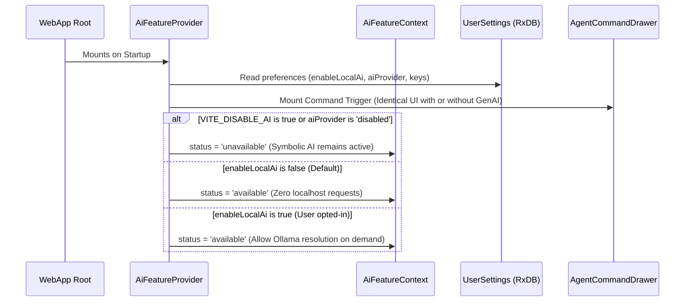

# GenAI Pre-flight & Availability Architecture

## Overview

Quozen's command input is **offline-first and deterministic**. The quick command drawer (`AgentCommandDrawer`) is always active and renders identically on device via Symbolic AI (`StandardCommandParser`), even if Generative AI (`GenAI`) is disabled in Profile settings, unreachable, or the device is completely offline.

Pre-flight checks govern **optional GenAI enhancement** without blocking core user workflows or exposing provider-specific UI chrome inside command entry dialogs.

## Privacy & Zero-Localhost Probing Guarantee

To prevent browser security warnings (Private Network Access popups when querying `localhost`), `@qozara/ai-client` (`AiProviderFactory`) guarantees:
- **Strict Opt-In Local Network Access**: Quozen will **never** probe or connect to `http://localhost:11434` (Ollama) unless the user explicitly enables **"Allow Local Network Access (Ollama)"** (`enableLocalAi: true`) under **Profile > Generative AI (GenAI)**.
- **Safe Automatic Waterfall**: When `enableLocalAi` is false (default), the `auto` resolution waterfall checks purely in-process or remote endpoints: BYOK Key -> `window.ai` (in-process Gemini Nano) -> Qozara Intelligence Cloud Proxy (`https://ai.qozara.org`).

## Resolution Flow

