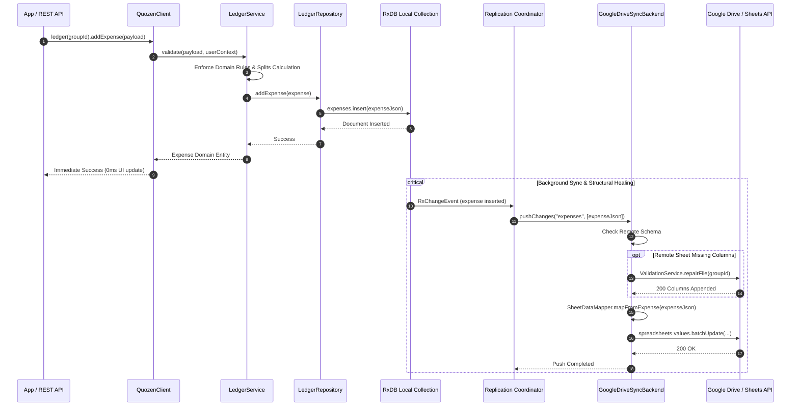

# Core Logic Architecture

## Request Execution Flow (Local-First Paradigm)

Below is the workflow of adding data (e.g., an Expense) using the local-first `@quozen/core` `QuozenClient`. 

Operations resolve with **0ms latency** against the local database, while replication and cloud structural validation occur asynchronously in the background.

