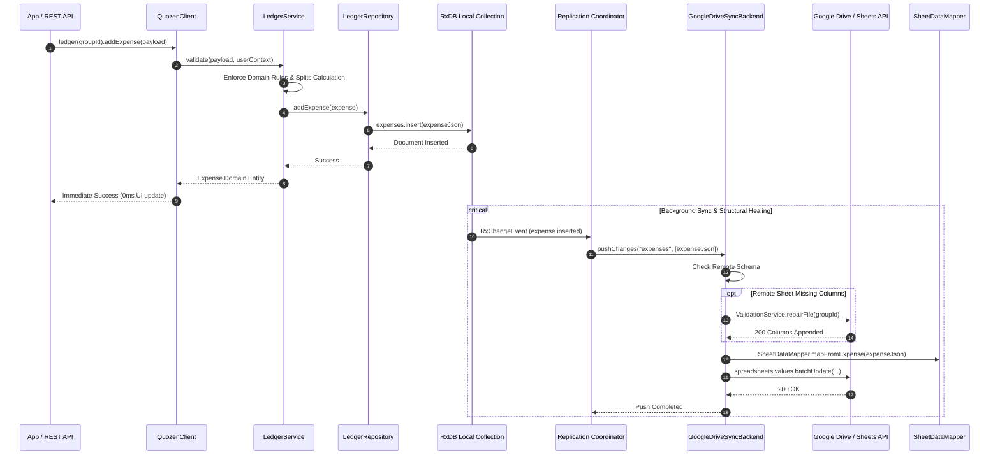

# Core Logic Architecture

## Request Execution Flow (Local-First Paradigm)

Below is the workflow of adding data (e.g., an Expense) using the local-first `@quozen/core` `QuozenClient`. 

Operations resolve with **0ms latency** against the local database, while replication and cloud structural validation occur asynchronously in the background.

## Domain Taxonomy: Group → Account → User

Quozen decouples authenticated Google identities (**Users**) from ledger balance entities (**Accounts**):

- **Group**: A collaborative expense ledger backed by a Google Spreadsheet.
- **Account** (`Member` row in the `Members` tab): A balance sheet and split unit within a Group.
  - **Personal Account**: Managed by a single logged-in User (`accountId === user.id`).
  - **Shared Account**: Co-managed by 2+ logged-in Users (e.g., `"Garcia Family"`). Counts as **1 share** in equal splits.
  - **Offline Account**: Managed on behalf of a non-logged-in participant by any logged-in group member.
- **User** (`User`): An authenticated Google identity (`id`, `email`, `name`).

### Active Account Resolution (`effectiveAccountId`)
- Each user's per-group account binding is stored in `UserSettings.groupCache[].accountId` (defaulting to `user.id` when omitted).
- `LedgerService` resolves `effectiveAccountId` via `activeAccountId ?? getActiveAccountId() ?? user.id`:
  - **Authorization**: `addExpense` authorizes mutations when either `user.id` or `effectiveAccountId` exists in `Members`.
  - **Zero Row Migration**: When `accountId` is explicitly linked (`accountId !== user.id`), `LedgerService.getLedger()` skips JIT `migrateUser` so the Shared or Offline Account's `userId` and historical rows remain untouched.

