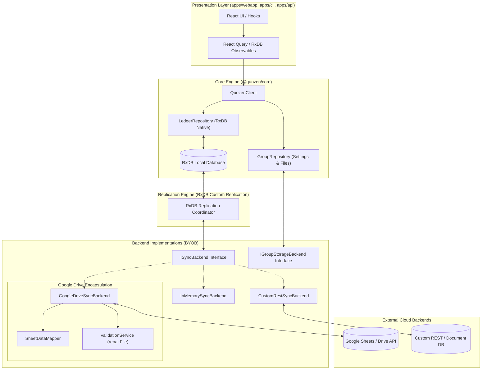

# Persistence Layer & Local-First Architecture Plan (Updated Specification)

This document outlines the architecture for overhauling the Quozen persistence layer. The design shifts from a synchronous, Google Sheets-dependent model to a **Local-First, Offline-Capable, Bring-Your-Own-Backend (BYOB)** architecture powered by RxDB.

---

## 1. Architectural Paradigm: True Decoupling & Local-First

The architecture cleanly decouples into four discrete layers: **Core Local Database (RxDB)**, **Domain Repositories**, **Sync & Replication Engine**, and **Backend Implementations (BYOB)**.



### 1.1 The Core App (RxDB Local Database)
The local database acts as the single source of truth for all ledger data:
- `LedgerRepository` reads and writes **exclusively** from local RxDB collections (`expenses`, `settlements`, `members`).
- **Zero-Latency CRUD**: Local mutations resolve instantaneously without awaiting remote roundtrips.
- **Offline Autonomy**: Read and write capabilities remain fully functional without internet access.
- **Local Migrations**: RxDB enforces JSON-to-JSON migrations locally when the schema increments (e.g. adding a new property). If an offline user receives an application update, RxDB migrates existing documents automatically.

### 1.2 The Interface Decoupling: Document Sync vs. Group Management
The legacy `IStorageLayer` coupled file system/drive operations with tabular spreadsheet updates. We cleanly partition this into two independent contracts:

1. **Document Synchronization (`ISyncBackend`)**:
   Used by the RxDB replication engine to exchange JSON documents with any remote persistence provider:
   ```typescript
   export interface SyncDocument {
       id: string;
       updatedAt: string;
       deletedAt?: string | null;
       [key: string]: any;
   }

   export interface ISyncBackend {
       pullChanges(collection: string, sinceCheckpoint?: string): Promise<{ documents: SyncDocument[]; checkpoint: string }>;
       pushChanges(collection: string, documents: SyncDocument[]): Promise<void>;
   }
   ```
   The replication engine is completely agnostic of tabular cells, row coordinates, or cloud provider APIs.

2. **Group & File Management (`IGroupStorageBackend`)**:
   Used exclusively by `GroupRepository` to handle file creation, listing, Google Drive permissions (for collaborator sharing and magic links), and serverless user settings (`quozen-settings.json`).

### 1.3 Unified & Declarative Migration Strategy
We unify data migrations between local JSON stores and remote Google Sheets:
1. **Local JSON Migration (RxDB)**: Handled offline by RxDB's `migrationStrategies`. The app remains available immediately upon code updates.
2. **Remote Structural Healing (`ValidationService`)**: When `GoogleDriveSyncBackend.pushChanges()` executes, it declaratively invokes `ValidationService.repairFile()` before updating rows. If new columns were added to the schema, they are appended to the remote Google Sheet automatically.
3. **Non-Blocking Reads**: `LedgerService.getLedger()` no longer synchronously blocks on remote `checkHealth()`. Structural repair is handled asynchronously during background sync.
4. **Deprecation of Imperative Remote Scripts**: With automatic structural repair and JSON migrations, manually written migration steps in `packages/core/src/schema/migrations/` are deprecated.

### 1.4 Backend Encapsulation (Google Drive)
All spreadsheet-specific translation is isolated inside `GoogleDriveSyncBackend`:
- **SheetDataMapper**: Converts incoming JSON documents into Google Sheets rows and translates row responses to JSON documents.
- **ValidationService**: Encapsulated within the adapter to perform declarative repairs.
- **Core Ignorance**: `@quozen/core` contains zero Google Sheets logic outside the adapter.

### 1.5 Multi-Runtime Storage Strategy
To support the monorepo's heterogeneous execution environments:
- **Browser (`apps/webapp`)**: Uses `getRxStorageDexie()` (Dexie / IndexedDB) for persistent offline storage.
- **Edge API (`apps/api`) & CLI (`apps/cli`) & Unit Tests**: Uses `getRxStorageMemory()` (in-memory) for high-performance, stateless execution without DOM or IndexedDB requirements.

---

## 2. Sync Engine & Conflict Resolution

### 2.1 Last-Write-Wins (LWW) & Soft Deletion
- **Timestamps**: All core entities (`Expense`, `Settlement`, `Member`) include `updatedAt: Date` and `deletedAt?: Date`.
- **Soft Deletion**: Deleting an item marks `deletedAt` with a timestamp rather than purging data immediately, allowing deletions to replicate reliably across offline peers.
- **LWW Conflict Resolution**: RxDB Custom Replication automatically resolves conflict between concurrent edits using the latest `updatedAt` timestamp.

### 2.2 Replication State Monitoring
- The legacy timer-based polling in `AutoSyncContext` is replaced with an event-driven status stream fed directly by the RxDB replication engine.
- Exposes states: `IDLE`, `SYNCING`, `ERROR`, `OFFLINE`.
- Route-based pausing is retired because local-first mutations never overwrite user input during background replication.

---

## 3. Implementation Steps

#### Phase 1: Models & RxDB Schema Foundation
- Add `updatedAt` and `deletedAt` to `Expense`, `Settlement`, and `Member` in `packages/core/src/domain/models.ts`.
- Install `rxdb`, `rxjs`, and storage adapters in `packages/core/package.json`.
- Define JSON schemas and database factory in `packages/core/src/db/`.
- Validate with unit tests covering schema creation, CRUD, and local migrations.

#### Phase 2: Local-First `LedgerRepository`
- Refactor `LedgerRepository` to perform CRUD exclusively against RxDB collections.
- Remove spreadsheet row maps (`expenseRowMap`, etc.) from `LedgerRepository`.
- Decouple `LedgerService.getLedger()` from synchronous remote schema health checks.
- Verify all financial calculations and split distributions pass existing unit tests.

#### Phase 3: BYOB Sync Interface & Google Drive Adapter
- Define `ISyncBackend` and `IGroupStorageBackend` in `packages/core/src/sync/`.
- Implement `GoogleDriveSyncBackend` encapsulating `SheetDataMapper` and `ValidationService.repairFile()`.
- Implement `InMemorySyncBackend` for testing.

#### Phase 4: RxDB Replication & Conflict Resolution
- Build `ReplicationCoordinator` wrapping RxDB's `replicateRxCollection`.
- Bind collections to `ISyncBackend` with LWW conflict resolution.
- Verify two-way synchronization and conflict handling with automated tests.

#### Phase 5: WebApp, Context & UI Integration
- Configure `getRxStorageDexie()` in `apps/webapp/src/lib/storage/index.ts`.
- Refactor `AutoSyncContext` to subscribe to RxDB replication status observables.
- Update React query / hook bindings in `dashboard.tsx` and `expenses.tsx` for 0ms reactivity.

---

## 4. Verification Plan

### Automated Verification
1. **Core Unit Tests**: Verify RxDB initialization, schema validation, and CRUD operations using in-memory storage.
2. **Replication & Conflict Resolution Tests**: Simulate simultaneous local and remote edits; verify LWW resolves state without loss.
3. **Adapter Translation Tests**: Ensure `GoogleDriveSyncBackend` correctly translates JSON changes to batch spreadsheet operations and triggers `repairFile()` when columns are missing.

### Manual & E2E Verification
1. **Offline Workflow**: Disconnect network, create and edit expenses, verify 0ms latency and data persistence across reload.
2. **Reconnection Sync**: Reconnect network and verify changes replicate cleanly to Google Drive.
3. **Multi-Tab / Multi-Client Concurrency**: Perform concurrent edits across two sessions and confirm LWW convergence.
