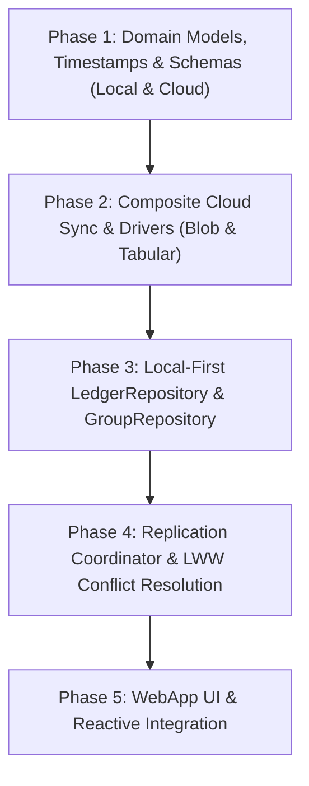

# Persistence Layer & Local-First Architecture Plan (Composite BYOS & Dual Migration Specification)

This document establishes the architecture for overhauling Quozen's persistence layer. The system transitions from a synchronous, Google Sheets-dependent model to a **Local-First, Offline-Capable, Bring-Your-Own-Storage (BYOS)** architecture powered by RxDB, adapting the battle-tested storage strategy pattern from Quomida.

---

## 1. Architectural Blueprint: The Composite Storage Pattern

Following the architecture established in Quomida (ADR 0010 & ADR 0013), persistence cleanly divides into a **Local Single Source of Truth (RxDB on IndexedDB)** and a **Composite Cloud Sync Provider** that routes collections according to their natural storage characteristics.

```
                     ┌──────────────────────────────────────────────┐
                     │            RxDB Database Layer               │
                     │  (Single local database in apps/webapp)      │
                     │                                              │
                     │  Collections:                                │
                     │  • user_settings                             │
                     │  • expenses (partitioned by groupId)         │
                     │  • settlements (partitioned by groupId)      │
                     │  • members (partitioned by groupId)          │
                     └──────────────────────┬───────────────────────┘
                                            │ SyncDeltaPayload
                                            ▼
                     ┌──────────────────────────────────────────────┐
                     │         CompositeCloudSyncProvider           │
                     └──────────────┬────────────────┬──────────────┘
                                    │                │
                      Collection    │                │ Collections:
                     user_settings  │                │ expenses, settlements,
                                    ▼                │ members (per active groupId)
                     ┌─────────────────────┐         ▼
                     │  BlobStorageDriver  │ ┌────────────────────────┐
                     └──────────┬──────────┘ │  TabularStorageDriver  │
                                │            └───────────┬────────────┘
                  Google Drive  │                        │ Google Sheets
                 appDataFolder  │                        │ (Individual Group Spreadsheets)
                                ▼                        ▼
                     quozen-settings.json    ┌─────────────────────────────────┐
                     (Private to User)       │ Quozen: Trip to Tokyo (GroupId) │
                                             │  ├── Expenses                   │ (Shareable via
                                             │  ├── Settlements                │  Drive Permissions)
                                             │  └── Members                    │
                                             ├─────────────────────────────────┤
                                             │ Quozen: Roommates (GroupId)     │
                                             │  ├── Expenses                   │
                                             │  ├── Settlements                │
                                             │  └── Members                    │
                                             └─────────────────────────────────┘
```

### 1.1 Local Single Source of Truth (`packages/core/src/db/`)
- A single local RxDB database maintains all application data across all groups.
- `LedgerRepository` reads and writes **strictly and exclusively** to local RxDB collections:
  - `user_settings`: User profile, active group pointer, cached groups list.
  - `expenses`: All expenses tagged with `groupId`.
  - `settlements`: All settlements tagged with `groupId`.
  - `members`: All members tagged with `groupId`.
- **Zero-Latency UI**: All user mutations complete in 0ms without waiting for remote cloud roundtrips.
- **Offline Autonomy**: Full read and write capabilities are preserved offline.

### 1.2 Routing Strategy: Private AppData Blob vs. Shared Group Spreadsheets
Cloud storage requirements differ fundamentally across domain boundaries:
1. **User Settings & Group Directory (`user_settings`)**:
   - Internal user configuration that belongs in hidden, tamper-resistant storage.
   - Handled by `BlobStorageDriver`: Persisted as a JSON blob (`quozen-settings.json`) in the user's private Google Drive `appDataFolder` (`spaces=appDataFolder`).
   - *Backward Compatibility*: If a legacy `quozen-settings.json` exists in the user's root Drive, the driver reads it, seamlessly migrates it to `appDataFolder`, and cleans up the root file.
2. **Collaborative Group Ledgers (`expenses`, `settlements`, `members`)**:
   - Transactional, shared financial records.
   - Handled by `TabularStorageDriver`: Each group is an independent Google Spreadsheet in the user's Drive (e.g. `Quozen: Trip to Tokyo`).
   - Group spreadsheets retain their native Google Drive permissions, allowing users to invite members, share magic links, and inspect/export data using Google Sheets.

---

## 2. Backward Compatibility & Existing Google Groups

A critical requirement is that **existing Google Drive group spreadsheets must continue working seamlessly without data loss or corruption**.

### 2.1 Dynamic Header Mapping (Resilience to Column Layouts)
Users or legacy versions may have created sheets with different column orderings. Row serialization and deserialization in `TabularStorageDriver`:
- Does **not** rely on hardcoded row array indices (`row[0]`, `row[3]`).
- Uses dynamic header lookup matching normalized column names (`id`, `date`, `amount`, `paidBy`, `splits`, `meta`, etc.).
- Trims whitespace and prevents formula injection (`=`, `+`, `-`, `@`).

### 2.2 Fallback Parsing for Legacy Rows
Existing spreadsheets (created under Schema v1) do not have dedicated `updatedAt` or `deletedAt` columns:
- **`updatedAt`**: Deserializer checks for `updatedAt` column first. If absent, it checks `meta.lastModified`, then `date`, then `createdAt`, and finally defaults to the epoch `new Date(0)`.
- **`deletedAt`**: If the `deletedAt` column is absent, rows default to `null` (active/not deleted).
- This guarantees that opening any existing Google Spreadsheet never crashes or drops data.

### 2.3 Automated Safety Backups Prior to Upgrades
Before any structural modification (migration or repair) is applied to an existing user spreadsheet in Google Drive:
- `TabularStorageDriver` / `ValidationService` calls `client.createBackup()`.
- Generates an automated Google Drive copy named `Backup of <SpreadsheetTitle> - <ISO timestamp>`.
- Only after the backup succeeds does the driver apply schema updates.

### 2.4 Non-Destructive Structural Healing
When new schema columns (such as `updatedAt` and `deletedAt`) are introduced to remote spreadsheets:
- Existing user data is never truncated or overwritten.
- `ValidationService.repairFile()` uses Google Sheets `appendDimension` and `updateCells` to append missing columns to the end of the sheet, preserving all existing rows and formulas.

---

## 3. The Three-Tier Version Tracking & Dual Migration Architecture

Following Quomida ADR 0013, Quozen manages two decoupled storage environments across three explicitly tracked version tiers:

```
┌───────────────────────────────────────────────────────────────────┐
│ Tier 1: Application Version                                       │
│ • SemVer Release (package.json) + Git Commit SHA                  │
│ • Defines active code, models, and migration scripts              │
└─────────────────────────────────┬─────────────────────────────────┘
                                  │
         ┌────────────────────────┴────────────────────────┐
         ▼                                                 ▼
┌───────────────────────────────────┐     ┌───────────────────────────────────┐
│ Tier 2: Local DB Version (RxDB)   │     │ Tier 3: Cloud Store Version       │
│ • RxDB collection schema version  │     │ • Google Drive appProperties      │
│ • Tracked in IndexedDB &          │     │   (quozen_schema_version)         │
│   localStorage schema hashes      │     │ • Google Sheets _migrations tab   │
│ • Runs 100% offline on boot       │     │ • Managed per connected provider  │
└───────────────────────────────────┘     └───────────────────────────────────┘
```

### 3.1 Tier 2: Local RxDB Migration Engine
- **Location**: `packages/core/src/db/schemas/`
- **Execution**: Runs synchronously on client boot via native RxDB `migrationStrategies`.
- **Offline Safety**: If the user's app updates while offline, local document schemas upgrade instantly. The user can continue adding expenses without network access.
- **Integrity Guard**: Build-time script (`scripts/validate-schemas.js`) guarantees every schema bump includes corresponding migration strategy functions.

### 3.2 Tier 3: Remote Cloud Migration & Repair Engine
- **Location**: `packages/core/src/schema/` via `@qozara/gdocs-schema`.
- **Execution**: Triggered during cloud sync handshake or via explicit repair workflows.
- **Workflow**:
  1. `ValidationService.checkHealth(spreadsheetId)` reads `appProperties.quozen_schema_version` and validates structural headers.
  2. If version is outdated (`UPGRADE_REQUIRED`) or columns are missing (`CORRUPTED`), background sync suspends and exposes status to `AutoSyncContext`.
  3. Clicking "Repair" or "Upgrade" in `SchemaRemediationModal` creates a safety backup, executes migrations/column repairs, updates `appProperties`, and resumes sync.

---

## 4. Multi-Runtime Storage Strategy

To support the heterogeneous execution runtimes across the Quozen monorepo:
- **Browser (`apps/webapp`)**: Uses `getRxStorageDexie()` (Dexie / IndexedDB) for persistent offline storage.
- **Edge API (`apps/api`) & Node CLI (`apps/cli`) & Vitest Unit Tests**: Uses `getRxStorageMemory()` for ultra-fast, stateless in-memory database execution without DOM dependencies.

---

## 5. Phased Implementation Plan



### Phase 1: Domain Models, Timestamps & Dual-Schema Definitions
1. **Timestamp Normalization**:
   - Add `updatedAt: Date` and `deletedAt?: Date` to `Expense`, `Settlement`, and `Member` in `packages/core/src/domain/models.ts`.
2. **RxDB Schemas (Tier 2)**:
   - Define collection schemas (`user_settings`, `expenses`, `settlements`, `members`) with `migrationStrategies` in `packages/core/src/db/schemas/`.
3. **Cloud Schemas (Tier 3)**:
   - Update `packages/core/src/schema/SchemaDefinition.ts` to include `updatedAt` and `deletedAt` columns for Google Sheets tabs (`Expenses`, `Settlements`, `Members`).
   - Define `@qozara/gdocs-schema` migration to upgrade legacy sheets from v1 to v2.
4. **Unit Tests**:
   - Write tests validating local RxDB migrations and Google Sheets schema validation.

### Phase 2: Composite Cloud Sync & Storage Drivers
1. **Blob Storage Driver (`BlobStorageDriver`)**:
   - Implement `GoogleDriveBlobDriver` targeting `spaces=appDataFolder` for `user_settings`.
   - Implement automatic migration from legacy root `quozen-settings.json` to `appDataFolder`.
2. **Tabular Storage Driver (`TabularStorageDriver`)**:
   - Implement `GoogleSheetsTabularDriver` managing individual group spreadsheets.
   - Implement dynamic header mapping and fallback parsing for legacy rows.
   - Integrate `createBackup()` before applying repairs or migrations.
3. **CompositeCloudSyncProvider**:
   - Implement routing table: `user_settings` ➔ Blob driver; `expenses`, `settlements`, `members` ➔ Tabular driver (for active `groupId`).
4. **In-Memory Mock Driver**:
   - Implement for fast, zero-credential automated integration tests.

### Phase 3: Local-First `LedgerRepository` & `GroupRepository`
1. **LedgerRepository Rewrite**:
   - Refactor `LedgerRepository` to perform queries and mutations strictly against local RxDB collections.
   - Remove spreadsheet row maps and synchronous sheet API calls from `LedgerRepository`.
2. **GroupRepository Refactor**:
   - Update `GroupRepository` to read/write `user_settings` locally in RxDB, synchronized via `BlobStorageDriver`.
   - Group creation and permission management operate via Drive file manager.
3. **Domain Integration**:
   - Ensure all financial algorithms (`LedgerService`, split distribution, balances) pass tests against RxDB.

### Phase 4: Replication Coordinator & Conflict Resolution
1. **Replication Coordinator**:
   - Wrap RxDB's `replicateRxCollection` with custom push/pull handlers communicating with `CompositeCloudSyncProvider`.
   - Setup Last-Write-Wins (LWW) conflict resolution using `updatedAt`.
2. **Sync State Management**:
   - Expose lifecycle states: `idle`, `syncing`, `upgrade_required`, `corrupted`, `error`, `offline`.
3. **Multi-Device Concurrency Tests**:
   - Test simultaneous offline edits resolving cleanly via LWW without duplicate or lost transactions.

### Phase 5: WebApp UI & Reactive Integration
1. **Storage Setup in WebApp**:
   - Initialize RxDB with `getRxStorageDexie()` in `apps/webapp/src/lib/storage/index.ts`.
2. **AutoSyncContext Refactor**:
   - Bind `AutoSyncContext` to the replication coordinator's status stream.
3. **Schema Remediation Flow**:
   - Connect `SchemaRemediationModal` to `CompositeCloudSyncProvider.repair()` and `migrate()`, displaying automated backup confirmations to the user.
4. **Reactive UI Query Hooks**:
   - Update dashboard and expense views to read from RxDB observables with 0ms latency.

---

## 6. Verification Criteria
- [ ] **Existing Groups Preserved**: Legacy Google Sheets groups open, parse, and synchronize without errors.
- [ ] **Zero Latency**: Local ledger CRUD operations complete in 0ms without network roundtrips.
- [ ] **Offline Full-Functionality**: App operates fully offline with automatic sync upon reconnection.
- [ ] **Tamper & Layout Resilience**: Manual column reordering in Google Sheets is handled gracefully via dynamic header mapping.
- [ ] **Safety Backups**: Remote repairs and migrations generate safety backups before applying structural changes.
- [ ] **Clean Test Suite**: All unit, integration, and monorepo build checks pass with 0 failures.
